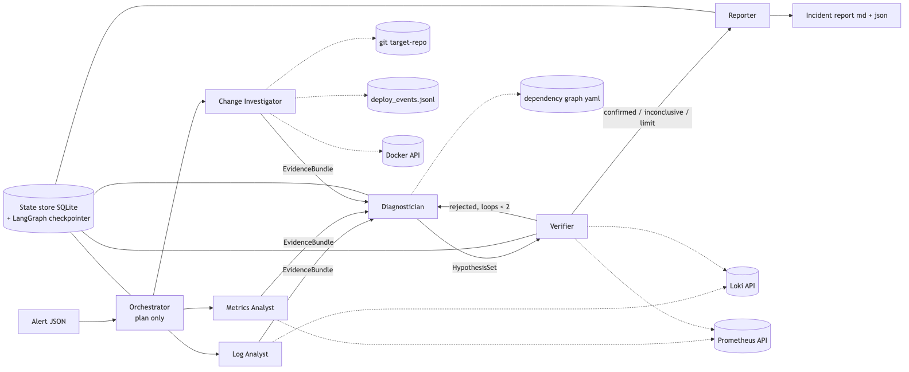

# Incident Responder

A **multi-agent LLM system for root-cause analysis in microservices**. It receives an alert, lets specialist agents investigate logs, metrics and recent changes, combines their evidence into ranked root-cause hypotheses, verifies the top one and writes an incident report.

To evaluate it objectively, the repository also contains:
- a small Go microservice backend (food ordering);
- a full observability stack (Prometheus, Loki, Grafana);
- a fault-injection harness that reproduces incident scenarios with known ground truth.

> Master's course "AI and Machine Learning", Astana IT University. Single source of truth: [SPEC.md](SPEC.md).



| Document | Contents |
|---|---|
| [docs/architecture.md](docs/architecture.md) | interaction scheme, agent loop, backend, anti-leakage boundary |
| [docs/agents.md](docs/agents.md) | agent table: role, inputs, outputs, tools, completion criterion |
| [docs/messages.md](docs/messages.md) | message schemas with JSON examples |
| [docs/design-decisions.md](docs/design-decisions.md) | why multi-agent, why these roles, trade-offs, limitations |

**Status:** Phase 1 (Assignment 2) is done.
- Backend: gateway, order and payment, plus Postgres and the observability stack.
- Scenario s01 can be injected.
- Prototype: **Log Analyst + Metrics Analyst → Diagnostician**, exchanging structured messages, with every call logged.

The remaining agents (Orchestrator, Change Investigator, Verifier, Reporter) arrive in Phase 3. See SPEC.md section 12.

---

## Prerequisites

- **Docker** Desktop or Engine with Compose v2. Give Docker **≥ 6 GB of memory**.
- **uv** (Python package manager): `brew install uv` or `curl -LsSf https://astral.sh/uv/install.sh | sh`. uv downloads Python 3.12 by itself.
- `make`, `git`, `curl`.
- Go ≥ 1.22 only for `make test`. The services are built inside Docker.
- An **OpenAI-compatible LLM endpoint**. Without one, you can still run everything with `LLM_PROVIDER=fake` (canned answers).

## Setup

```bash
cp .env.example .env        # then edit the LLM section (see below)
make target-init            # creates target-repo/ (a separate git repo the services are built from)
make up                     # builds and starts everything, waits until healthy (~1 min the first time)
```

Then open Grafana at http://localhost:3000 (dashboard "Shop — service overview"). Prometheus is at http://localhost:9090.

### Choosing an LLM provider

Any OpenAI-compatible endpoint works. Set three variables in `.env`:

| Provider | `LLM_BASE_URL` | `LLM_MODEL` (example) |
|---|---|---|
| OpenAI | `https://api.openai.com/v1` | `gpt-4o-mini` |
| Gemini | `https://generativelanguage.googleapis.com/v1beta/openai/` | `gemini-2.5-flash` |
| OpenRouter | `https://openrouter.ai/api/v1` | `openai/gpt-4o-mini` |
| Ollama (local) | `http://localhost:11434/v1` (`LLM_API_KEY=ollama`) | `qwen2.5:7b` (needs tool-calling support) |

Also set `LLM_API_KEY=...`. The key is read only from the environment or `.env`, which is gitignored; it never appears in code.

**Free tiers:** set `LLM_MAX_RPM` to your requests-per-minute quota. For example, the Gemini free tier allows 5 per minute per model, so use `LLM_MAX_RPM=5`. Calls are then paced instead of failing with 429. One investigation needs about 10–15 LLM calls. `LLM_MODEL=… make investigate …` switches the model for a single run.

For an offline dry run, set `LLM_PROVIDER=fake`. Every agent then returns a deterministic canned answer, marked `[fake]`. The tools still query the live stack. This mode is meant for tests and plumbing checks, not for real diagnosis.

## Demo (3 commands)

```bash
make scenario S=s01                       # inject: payment becomes 2 s slower; waits ~90 s, writes alerts/s01.json
make investigate ALERT=alerts/s01.json    # the agents investigate the alert
make reset                                # back to the healthy baseline
```

`make investigate` prints a live trace of every agent action. These lines are from a real run with `gemini-3.5-flash`:

```
         planner → window 12:37:06–13:00:30 UTC, focus: gateway, inventory, payment, order, redis, postgres, nats
 metrics_analyst → targets_health() ✓ 3 ms
     log_analyst → error_pattern_summary(start=…, end=…) ✓ 331 ms
 metrics_analyst → zscore_anomaly(promql=histogram_quantile(0.95, sum by (le, service, route) (rate(http_request_duration_se…) ✓ 10 ms
     log_analyst → loki_query(logql={service="payment"} | json, …) ✓ 24 ms
 metrics_analyst → done: 3 evidence item(s), status=ok
     log_analyst → waited 55 s (LLM_MAX_RPM=5)
     log_analyst → done: 1 evidence item(s), status=ok
   diagnostician → dependency_graph() ✓ 0 ms
   diagnostician → top hypothesis: payment / latency (confidence 0.80)
```

It then prints two tables: the evidence from each specialist and the ranked root-cause hypotheses. Expected result for s01: **root cause `payment`, fault type `latency`**. The alert only says that the *gateway* is slow.

Other scenario commands: `uv run --project agents python -m chaos list` lists scenarios; `... chaos apply s01` injects a fault without waiting.

## Where the output goes

| What | Where |
|---|---|
| Call log: one JSON line per LLM call and per tool call (agent, latency, status, attempt, tokens) | `logs/run_<run_id>.jsonl` |
| Final state of a run (plan, evidence bundles, hypotheses, failures) | `logs/run_<run_id>_result.json` |
| Committed sample run (for grading) | `logs/sample/` |
| Generated alerts | `alerts/` |
| Incident reports (Phase 3) | `reports/` |

The CLI also prints each agent's share of all calls. The requirement is that no agent exceeds 40%.

## Tests

```bash
make test        # pytest (schemas, tool logic, anti-leakage, graph with fake LLM) + go test
```

The graph tests run the real tool code against a mocked Prometheus/Loki API with the fake LLM. They check:
- routing and the structured hand-off;
- budgets and the repair call;
- retries and graceful degradation;
- that every call is logged.

## Evaluation

`make eval` runs every scenario several times and scores the results against the ground truth. It arrives in Phase 4 (`eval/run_all.py`, `eval/load_report.py`).

## All make targets

```
make target-init   create target-repo/ (first time only)
make up            build + start everything, wait until healthy
make down          stop everything and delete its data
make reset         back to the healthy baseline (clear faults, reset target-repo)
make scenario      inject a scenario and write its alert: make scenario S=s01
make investigate   run the agents on an alert: make investigate ALERT=alerts/s01.json
make test          unit tests (pytest + go test)
make eval          run all scenarios and score them (Phase 4)
make load-report   per-agent share of calls (Phase 4)
```

## Repository layout

```
services/        Go services (gateway, order, payment; Phase 2: inventory, notification) + pkg/obs
target-repo/     (gitignored) git repo copied from services/; compose builds from here
infra/           Prometheus (+ alert rules), Loki, Alloy, Grafana (datasources + dashboard), Toxiproxy, Postgres seed
loadgen/         Go load generator (always-on background traffic)
chaos/           fault injection CLI (Toxiproxy, later docker stop / deploy simulator)
scenarios/       sNN_*.yaml: fault + alert + expected root cause
agents/          Python package `responder` (uv project)
  responder/     schemas, llm, runtime, calllog, graph, cli, agents/ (+ prompts/), tools/
  tests/         pytest
docs/            architecture, agents, messages, design decisions
```

## Troubleshooting

| Problem | Fix |
|---|---|
| `make up` fails with "port is already allocated" | Something else uses 8080–8082, 3000, 3100, 9090 or 8474. Stop it (`lsof -i :8080`) or change the host port in `docker-compose.yml`. |
| Containers restart or are OOM-killed | Give Docker ≥ 6 GB of memory (Docker Desktop → Settings → Resources). |
| `target-repo/ is missing` | Run `make target-init` once. |
| `LLM_API_KEY is not set` | `cp .env.example .env` and fill in the LLM section, or use `LLM_PROVIDER=fake`. |
| `429 … exceeded your current quota` | Set `LLM_MAX_RPM` to your plan's per-minute limit (Gemini free tier: 5). If the *daily* quota is used up, switch `LLM_MODEL`: quotas are per model. |
| `503 … model is currently experiencing high demand` | The provider is overloaded (temporary). Retry later, or use another model, e.g. `LLM_MODEL=gemini-3.5-flash make investigate ALERT=…`. |
| `400 … missing a thought_signature` | Fixed: the runtime sends Gemini's assistant messages back unchanged. If you see it, you are on an old checkout. |
| `make scenario` says gateway is not healthy | `make reset` (or `make up`), then retry. |
| Metrics evidence says "series did not exist in the baseline" | The stack was started very recently. `make scenario` waits for a warm-up, but give it a couple of minutes of normal traffic first. |
| No logs in Grafana right after `make up` | Loki needs ~15–30 s. `make up` waits for Loki to be ready. |
| Start from scratch | `make down && rm -rf target-repo && make target-init && make up` |
