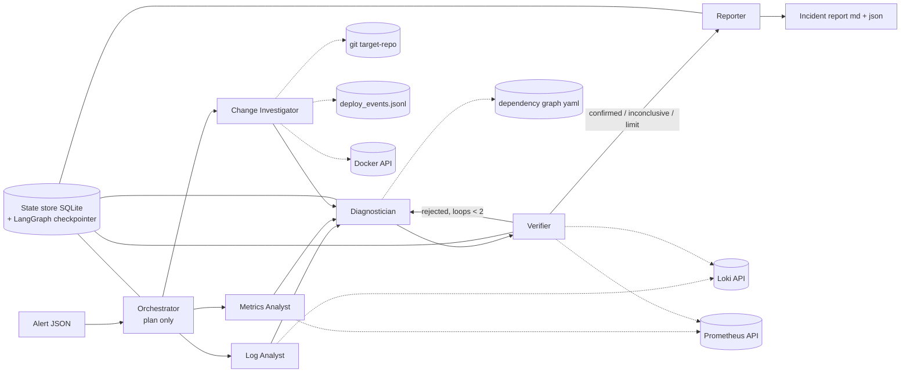

# Incident Responder — Multi-Agent System for Microservice Root-Cause Analysis

> **For Claude Code.** This file is the single source of truth for the project.
> Read it fully before writing any code. Work phase by phase (section 12).
> Hard constraints in section 2 are graded requirements — never violate them.

---

## 0. How to work on this project

- **The student must defend this code orally** ("Ответы на вопросы, понимание кода" = 25% of the exam grade). Therefore:
  - Prefer simple, explicit code over clever abstractions. No frameworks beyond those listed in section 3.
  - Every module starts with a short docstring/comment explaining *what it does and why it exists*.
  - After finishing each phase, give the student a short walkthrough: what was built, which files matter, how to run it, what to look at.
- Before starting a phase, state the plan for that phase in a few bullets, then implement.
- After each phase, update the checkboxes in section 12 of this file and make a git commit (`phase N: <summary>`).
- Do **not** change decisions marked **[FIXED]** without asking the student first. Anything not specified here: choose the simplest reasonable option and note it in `docs/design-decisions.md`.
- Never commit secrets. API keys only via `.env` (gitignored); keep `.env.example` up to date.
- Keep the Go services small (150–300 lines each). The services are a **stage** for incidents, not the product. The product is the agent system.

---

## 1. Project summary

A multi-agent LLM system that receives an alert from a microservice backend, investigates logs, metrics and recent changes, identifies the **root cause** (which service/component and what type of fault), verifies the hypothesis against the data, and writes an incident report.

To evaluate it objectively, the repo also contains a small Go microservice backend (food-ordering domain), an observability stack, and a **fault-injection harness** that reproduces 12 incident scenarios with known ground truth.

**Course context:** Master's course "AI and Machine Learning" (Astana IT University). Graded in three stages:

| Stage | Due | Must be ready |
|---|---|---|
| Assignment 2 | end of week 1 of this plan (≈ 11 Oct 2026) | Architecture, spec of all agents, prototype where ≥2 agents exchange data, README |
| Assignment 4 | end of week 5 of this plan (≈ 8 Nov 2026) | All agents working together, logging, error handling, ≥5 passing test scenarios |
| Exam | exam session | Final version, demo, 10+ scenarios, report (5–10 pages), ≤10 slides, defense |

---

## 2. Hard requirements from the assignment (graded) **[FIXED]**

Agents
1. ≥4 agents (we build **7**; grading rubric rewards 5+ and a verifier agent), each with **one clear role**.
2. For each agent: role, inputs, outputs, tools, completion criterion — documented in `docs/agents.md`.
3. Roles do not overlap.
4. **No agent performs more than 40% of all LLM + tool calls** in a typical scenario. Must be proven by logs (`eval/load_report.py`).
5. **Max 5 tools per agent.**
6. The orchestrator only plans and distributes work; it does **no domain analysis**.

Interaction & data
7. Interaction scheme shown on an architecture diagram.
8. Agents exchange **structured messages** (Pydantic models, serialized as JSON).
9. ≥2 external tools/data sources (we use: Prometheus API, Loki API, git, Docker API, deploy log file).
10. Task state is stored **explicitly** (SQLite store + LangGraph checkpointer).

Reliability & safety
11. Limits on number of steps and wall-clock time; loop protection.
12. Error handling: retries, clear message on failure.
13. Logging of **every** agent call and tool call.
14. API keys are not in code.

Deliverables
15. Git repo with README (setup, configuration, usage example).
16. Architecture diagram (agents, links, tools).
17. Agent table (role, inputs/outputs, tools).
18. Test scenarios with expected results: ≥4 for A4 (rubric says 5+, we target all 12), ≥10 for exam.
19. Logs of a typical-scenario run proving load distribution.
20. Exam: report 5–10 pages + presentation ≤10 slides (student writes these; code should produce the figures/tables they need).

Grading notes: "system solves 90%+ of test scenarios" is required for the top band. A system that does not start at the defense gets ≤49 points. Reliability of `make up` is therefore critical.

---

## 3. Tech stack **[FIXED]**

| Layer | Choice |
|---|---|
| Services | Go ≥1.22, stdlib `net/http` (method routing), `log/slog` JSON logs, `prometheus/client_golang`, `jackc/pgx/v5` (pgxpool), `redis/go-redis/v9`, `nats-io/nats.go` |
| Infra | Docker Compose: PostgreSQL 16, Redis 7, NATS 2 (JetStream not needed), Prometheus, Loki, **Grafana Alloy** (log shipping; Promtail is deprecated), Grafana, Toxiproxy |
| Agents | Python ≥3.11, `uv` for dependency management, **LangGraph** (graph + checkpointer), Pydantic v2, `openai` SDK against an OpenAI-compatible endpoint, `httpx`, `tenacity`, `docker` (Python SDK), `typer` (CLI), `rich` (CLI output) |
| LLM | Any OpenAI-compatible endpoint configured via env (`LLM_BASE_URL`, `LLM_API_KEY`, `LLM_MODEL`) — works with OpenAI, Gemini (OpenAI-compatible endpoint), OpenRouter, or local Ollama. Plus a `fake` provider for tests. temperature = 0. |
| Harness | Python (`chaos/` package) + Go load generator |
| Tests | `pytest` for Python, `go test` for services (minimal) |

Target host: macOS or Linux with Docker Desktop / Docker Engine. All images must be multi-arch (arm64 + amd64).

---

## 4. Repository layout

```
incident-responder/
├── SPEC.md                    # this file
├── README.md
├── Makefile
├── .env.example
├── docker-compose.yml
├── infra/
│   ├── prometheus/prometheus.yml, rules.yml
│   ├── loki/config.yml
│   ├── alloy/config.alloy
│   ├── grafana/provisioning/... (datasources + 1 dashboard)
│   └── toxiproxy/toxiproxy.json
├── services/                  # canonical source of the Go services (copied into target-repo)
│   ├── gateway/ order/ payment/ inventory/ notification/
│   └── pkg/obs/               # shared: slog setup, metrics, /healthz, /admin/chaos
├── target-repo/               # GITIGNORED. Separate git repo created by `make target-init`.
│                              # Compose builds services from here; deploy-sim commits here.
├── chaos/                     # Python package: fault injection + deploy simulator
│   ├── cli.py                 # `python -m chaos apply s04` / `reset`
│   ├── faults.py              # toxiproxy, docker stop/start, /admin/chaos flags
│   ├── deploy_sim.py          # apply patch → commit → rebuild → append deploy event
│   └── patches/               # *.patch files used by bad-deploy scenarios
├── loadgen/                   # Go load generator (rps, duration, endpoint mix)
├── agents/                    # Python package `responder`
│   ├── pyproject.toml
│   └── responder/
│       ├── cli.py             # `responder investigate --alert alert.json`
│       ├── graph.py           # LangGraph wiring + routing (code, not LLM)
│       ├── schemas.py         # all message types (section 7)
│       ├── llm.py             # OpenAI-compatible client, JSON validation, retries, fake provider
│       ├── runtime.py         # agent loop: bounded tool-calling, budgets, call logging
│       ├── state_store.py     # SQLite persistence
│       ├── calllog.py         # JSONL call logger
│       ├── agents/            # one file per agent + prompts/*.md
│       └── tools/             # loki.py prometheus.py git.py docker.py deploys.py topology.py report.py
├── scenarios/                 # s01_*.yaml … s12_*.yaml (fault + alert + ground truth)
├── eval/
│   ├── run_scenario.py        # reset → inject → load → wait → alert → investigate → score → teardown
│   ├── run_all.py             # all scenarios × N repeats → results table
│   ├── load_report.py         # per-agent share of calls from JSONL logs (proves ≤40%)
│   └── baseline_single_agent.py   # STRETCH: one agent with all tools, for comparison only
├── data/                      # GITIGNORED: incidents.db, deploy_events.jsonl
├── logs/                      # GITIGNORED except logs/sample/ (committed sample run for grading)
├── reports/                   # generated incident reports (md + json)
└── docs/
    ├── architecture.md        # Mermaid diagram + explanation (+ exported PNG)
    ├── agents.md              # agent table (required deliverable)
    ├── messages.md            # message schemas with JSON examples
    ├── scenarios.md           # scenario table with expected results
    ├── design-decisions.md    # why multi-agent, why these roles, trade-offs, limitations
    └── results.md             # latest eval results + load distribution
```

---

## 5. Target backend (the system under investigation)

### 5.1 Services

| Service | Port | Endpoints | Dependencies (all through Toxiproxy) |
|---|---|---|---|
| gateway | 8080 | `GET /api/products`, `POST /api/orders`, `GET /api/orders/{id}` | inventory, payment, order |
| order | 8081 | `POST /orders`, `GET /orders/{id}` | PostgreSQL, NATS (publishes `orders.created`) |
| payment | 8082 | `POST /charge` (mock provider: ~50 ms base latency, configurable failure rate) | — |
| inventory | 8083 | `GET /products`, `POST /reserve` | Redis (read cache), PostgreSQL (fallback on cache error) |
| notification | 8084 | — (subscriber only) | NATS (subscribes `orders.created`, logs "notification sent") |

`POST /api/orders` flow in gateway: `inventory /reserve` → `payment /charge` (with **configurable retries**, default 3, needed for the cascade scenario) → `order /orders`.

Every service also exposes: `GET /healthz`, `GET /metrics`, `POST /admin/chaos` (internal-only fault flags, see 5.4), and a `build_info{service,version,commit}` gauge set from build args.

Configuration via env vars **and** a small `config.yaml` per service checked into the target repo (so misconfiguration scenarios produce a real git diff).

### 5.2 Logging (JSON via slog) — standard fields

`ts, level, service, msg, route, method, status, latency_ms, trace_id, error, upstream` — every request logs one line; every upstream/DB/cache error logs a line with `error` and `upstream`. Propagate `X-Trace-Id` from gateway to downstream calls.

### 5.3 Metrics — standard names (all services use `pkg/obs`)

- `http_requests_total{service,route,method,status}`
- `http_request_duration_seconds` histogram `{service,route}`
- `upstream_requests_total{service,target,status}`, `upstream_request_duration_seconds{service,target}`
- `db_query_duration_seconds{service,query}`
- `db_pool_acquired_conns`, `db_pool_max_conns`, `db_pool_acquire_duration_seconds`
- `cache_requests_total{service,result="hit|miss|error"}`
- `events_published_total{service,status}`, `events_consumed_total{service}`
- default Go collectors (`go_goroutines`, `go_memstats_heap_alloc_bytes`, …)
- `build_info{service,version,commit}`

### 5.4 Fault hooks (`POST /admin/chaos`)

JSON body toggles in-process faults: `{"leak_memory": bool, "leak_goroutines": bool, "cpu_burn": bool}`. Available only on the internal Docker network. **Agents never get a tool that reads chaos state** (see 6.4).

### 5.5 Infra

- **Toxiproxy** proxies: `gateway→order`, `gateway→inventory`, `gateway→payment`, `order→postgres`, `inventory→postgres`, `inventory→redis`, `order→nats`. Defined in `infra/toxiproxy/toxiproxy.json`.
- **Prometheus** scrapes all services every 5 s. `rules.yml` contains `HighErrorRate` and `HighLatency` (used for demo; the harness builds alerts itself).
- **Loki + Alloy**: Alloy discovers containers via the Docker socket and ships stdout to Loki with labels `service`, `container`.
- **Grafana**: provisioned datasources + one dashboard (RPS, error rate, p95 latency per service, goroutines, heap) — for the live demo.
- Seed data: ~20 products, stock levels, created by a SQL init script.

### 5.6 Target repo & deploy simulator

- `make target-init`: copies `services/` into `target-repo/`, runs `git init`, commits, tags `baseline`.
- `docker-compose.yml` builds service images from `target-repo/<service>` with build args `VERSION`, `COMMIT`.
- `chaos/deploy_sim.py deploy <service> <patch>`: `git apply` patch → commit with a realistic message & author → `docker compose up -d --build <service>` → append to `data/deploy_events.jsonl`: `{ts, service, version, commit, author, message}`.
- `make reset`: `git reset --hard baseline` in target-repo, rebuild changed services, clear toxics, start stopped containers, disable chaos flags, truncate deploy events **after** the baseline "noise" deploys (see below).
- To prevent the trivial heuristic "the latest deploy is always guilty", `reset` also performs 1–2 **harmless** deploys (e.g., log message change in an unrelated service) a few minutes before each scenario. Ground truth must not always be a deploy.

### 5.7 Load generator

`loadgen` (Go): flags `--rps`, `--duration`, `--mix` (default: 60% `GET /api/products`, 30% `POST /api/orders`, 10% `GET /api/orders/{id}`). Runs in the background during every scenario.

---

## 6. Agent system

### 6.1 Architecture



Pattern: **orchestrator + parallel specialists + verify loop** (hierarchical with a pipeline tail). Routing between nodes is done **in code** by LangGraph conditional edges, not by LLM calls — this keeps the orchestrator's share of calls low and the control flow deterministic.

### 6.2 Agents **[FIXED roles]**

| # | Agent | Role (one sentence) | Input | Output | Tools (≤5) | Completion criterion |
|---|---|---|---|---|---|---|
| 1 | **Orchestrator** | Turns the alert into an investigation plan and assigns tasks; no analysis. | `Alert` | `InvestigationPlan` (time window, focus services, task per specialist) | none | Valid plan produced (1 LLM call) |
| 2 | **Log Analyst** | Finds error patterns, their onset time and affected services in logs. | `Task` | `EvidenceBundle` | `loki_query`, `loki_label_values`, `error_pattern_summary` | ≥1 evidence item or explicit "no anomalies", within budget |
| 3 | **Metrics Analyst** | Finds anomalies in latency, error rate, resources, pool/cache/event metrics. | `Task` | `EvidenceBundle` | `prom_query`, `prom_query_range`, `zscore_anomaly`, `targets_health` | same as above |
| 4 | **Change Investigator** | Finds deploys, commits, config changes and container restarts near the incident window. | `Task` | `EvidenceBundle` (incl. suspect commit if any) | `deploy_events`, `git_log`, `git_diff`, `docker_inspect` | same as above |
| 5 | **Diagnostician** | Combines all evidence into ranked root-cause hypotheses. | all `EvidenceBundle`s (+ previous `Verdict` on retry) | `HypothesisSet` (ranked, ≤3) | `dependency_graph` | ≥1 hypothesis with evidence references |
| 6 | **Verifier** | Independently tests the top hypothesis against fresh queries; accepts or rejects with reasons. | top `Hypothesis` + `InvestigationPlan` | `Verdict` (confirmed / rejected / inconclusive) | `prom_query`, `loki_query`, `health_check` | verdict with ≥1 check performed |
| 7 | **Reporter** | Writes the final incident report and recommended actions. | plan, evidence, hypotheses, verdict | `IncidentReport` (+ md file) | `write_report` | report saved |

Why multi-agent (goes into `docs/design-decisions.md`, worth 15 points at A2):
- Three independent data sources → three specialists with narrow toolsets, run in parallel. One agent would need ~14 tools (assignment allows max 5) and one huge context.
- Separation of **hypothesis generation** (Diagnostician) from **hypothesis testing** (Verifier) prevents self-confirmation.
- Each specialist has a small, focused prompt → fewer hallucinations, easier to test in isolation.
- (Stretch, section 10.4) empirical comparison with a single-agent baseline.

### 6.3 Expected call budget per typical run (must keep every agent ≤40%)

| Agent | LLM calls | Tool calls |
|---|---|---|
| Orchestrator | 1 | 0 |
| Log / Metrics / Change (each) | 1–3 | 2–4 |
| Diagnostician | 1–2 | 1 |
| Verifier | 1–2 per loop | 2–3 |
| Reporter | 1 | 1 |

Total ≈ 25–35 calls; the largest agent should be ≈15–25%. Per-agent hard caps enforce this (6.5).

### 6.4 Tools — contracts

All tools: typed inputs (Pydantic), return compact JSON (truncate to stay under ~2k tokens), read-only except `write_report`, logged via `calllog`, wrapped in retry (6.5).

| Tool | Signature (simplified) | Notes |
|---|---|---|
| `loki_query` | `(logql: str, start, end, limit=100)` → lines | Loki `/loki/api/v1/query_range` |
| `loki_label_values` | `(label: str)` → values | discover services |
| `error_pattern_summary` | `(service: str \| None, start, end)` → `[{pattern, count, first_seen, last_seen, example}]` | normalizes messages (strip ids/numbers), groups, top 10 |
| `prom_query` | `(promql: str, at)` → instant vector | `/api/v1/query` |
| `prom_query_range` | `(promql, start, end, step="15s")` → series summary | return min/max/mean/last + change point, not raw points |
| `zscore_anomaly` | `(promql, baseline_window, incident_window)` → `{zscore, baseline_mean, incident_mean}` | pure Python, no LLM |
| `targets_health` | `()` → `[{job, up}]` | `/api/v1/targets` |
| `deploy_events` | `(start, end)` → events | reads `data/deploy_events.jsonl` (kept outside Postgres so it works when the DB is down) |
| `git_log` | `(since, until, path=None)` → commits | read-only on `target-repo` |
| `git_diff` | `(commit)` → diff (truncated) | |
| `docker_inspect` | `(service)` → `{state, restart_count, oom_killed, started_at, image}` | read-only Docker SDK |
| `dependency_graph` | `()` → static topology from `agents/responder/topology.yaml` | |
| `health_check` | `(service)` → `{status_code, latency_ms}` | GET `/healthz` |
| `write_report` | `(report: IncidentReport)` → path | writes `reports/<incident_id>.md/.json` |

**Anti-leakage rule [FIXED]:** no agent tool may read `scenarios/`, `chaos/`, `/admin/chaos`, Toxiproxy's API, or the harness state. The system must discover the root cause only from observability data, git, deploy log and Docker state — exactly what a real on-call engineer has. Add a unit test that asserts the tool registry contains only the tools above.

### 6.5 Runtime, limits, error handling **[FIXED values, configurable via env]**

- Agent loop (`runtime.py`): LLM with native function calling, bounded: `MAX_TOOL_CALLS_PER_AGENT=4`, `MAX_LLM_CALLS_PER_AGENT=3`.
- Graph limits: `MAX_GRAPH_STEPS=25` (LangGraph `recursion_limit`), `RUN_TIMEOUT_S=180`, `MAX_VERIFY_LOOPS=2`.
- Retries: `tenacity` exponential backoff (3 attempts) for LLM and tool HTTP errors/timeouts. Per-tool timeout 10 s.
- Structured output: LLM must return JSON matching the agent's output schema → validate with Pydantic → on failure, one "repair" call with the validation error → on second failure, the agent returns a typed `AgentFailure`.
- Degradation: if a specialist fails, the graph continues with remaining evidence and the report states it explicitly (e.g., "Metrics source unavailable — diagnosis based on logs and changes only, confidence lowered").
- On timeout/step limit: Reporter is invoked with whatever state exists and status `partial`. The CLI prints a clear human-readable message; exit code ≠ 0 only for total failure.
- Loop protection: Verifier loop counter in state; identical hypothesis re-proposed → treated as rejected-final.

### 6.6 State

- `state_store.py`: SQLite `data/incidents.db` with tables `incidents`, `plans`, `evidence`, `hypotheses`, `verdicts`, `reports` (JSON columns). Every node writes its output here.
- LangGraph `SqliteSaver` checkpointer for graph state (resume/debug).

### 6.7 Call logging

Every LLM call and tool call → one line in `logs/run_<run_id>.jsonl`:

```json
{"ts":"…","run_id":"…","incident_id":"…","agent":"metrics_analyst","call_type":"llm|tool",
 "name":"prom_query_range","latency_ms":412,"status":"ok|error|retry","attempt":1,
 "tokens_in":812,"tokens_out":96,"error":null}
```

Also emit a human-readable trace to the console with `rich` (agent → action → short result) for the demo.

`eval/load_report.py logs/run_<id>.jsonl` prints a table: agent | LLM calls | tool calls | total | share % | ✅/❌ (≤40%), and writes it to `docs/results.md`.

---

## 7. Message schemas (`schemas.py`) **[FIXED field names]**

```python
FaultType = Literal["latency", "dependency_down", "bad_deploy", "memory_leak",
                    "goroutine_leak", "resource_exhaustion", "misconfiguration",
                    "slow_query", "no_fault"]

class Alert(BaseModel):
    alert_name: str; service: str; severity: Literal["warning","critical"]
    started_at: datetime; summary: str; labels: dict[str, str] = {}

class Task(BaseModel):
    task_id: str; agent: str; objective: str
    window_start: datetime; window_end: datetime; focus_services: list[str]

class InvestigationPlan(BaseModel):
    incident_id: str; alert: Alert; window_start: datetime; window_end: datetime
    focus_services: list[str]; tasks: list[Task]

class Evidence(BaseModel):
    evidence_id: str; source: Literal["logs","metrics","changes","verification"]
    service: str; signal: str            # e.g. "p95 latency of POST /charge 2.3s vs 0.06s baseline"
    observed_at: datetime | None; strength: float  # 0..1
    raw_ref: str | None                  # the query / commit sha that produced it

class EvidenceBundle(BaseModel):
    agent: str; task_id: str; status: Literal["ok","partial","failed"]
    evidence: list[Evidence]; notes: str = ""

class Hypothesis(BaseModel):
    hypothesis_id: str; root_cause_service: str; fault_type: FaultType
    explanation: str; supporting_evidence: list[str]  # evidence_ids
    suspect_commit: str | None = None; confidence: float

class HypothesisSet(BaseModel):
    hypotheses: list[Hypothesis]  # ranked, max 3

class Verdict(BaseModel):
    hypothesis_id: str; status: Literal["confirmed","rejected","inconclusive"]
    checks: list[Evidence]; reasoning: str

class IncidentReport(BaseModel):
    incident_id: str; status: Literal["complete","partial","failed"]
    root_cause_service: str; fault_type: FaultType; confidence: float
    suspect_commit: str | None; summary: str; timeline: list[str]
    evidence_refs: list[str]; recommended_actions: list[str]
    limitations: list[str]

class AgentFailure(BaseModel):
    agent: str; error: str; attempts: int
```

`docs/messages.md` must show one real JSON example of each (taken from an actual run).

---

## 8. Test scenarios **[FIXED list]**

Each `scenarios/sNN_*.yaml`:

```yaml
id: s01_payment_latency
description: Payment provider becomes slow (+2s per request).
setup:                      # executed by chaos CLI
  - toxic: {proxy: gateway_payment, type: latency, latency_ms: 2000}
load: {rps: 15, duration_s: 180}
warmup_s: 60                # healthy traffic before fault
observe_s: 90               # fault active before alert fires
alert:                      # what the system receives — the SYMPTOM, not the cause
  alert_name: HighLatency
  service: gateway
  severity: critical
  summary: "p95 latency of POST /api/orders > 1s"
expected:
  root_cause_service: payment
  fault_type: latency
  accepted_services: []     # alternative services also counted as correct
  must_not_blame: [gateway]
```

| # | Fault (how injected) | Alert (symptom) | Expected root cause |
|---|---|---|---|
| s01 | Toxiproxy +2 s latency gateway→payment | gateway HighLatency | payment / latency |
| s02 | `docker stop postgres` | gateway HighErrorRate | postgres / dependency_down |
| s03 | `docker stop redis` | inventory HighLatency | redis / dependency_down |
| s04 | deploy-sim: patch adds nil-pointer bug in order handler | gateway HighErrorRate | order / bad_deploy (+ commit sha) |
| s05 | `/admin/chaos leak_memory` on notification | notification restarts / heap growth | notification / memory_leak |
| s06 | deploy-sim: `config.yaml` sets order DB pool `max_conns: 2` | gateway HighLatency + timeouts | order / resource_exhaustion (+ suspect commit = the config change) |
| s07 | `docker stop nats` | order EventPublishErrors | nats / dependency_down (orders still succeed) |
| s08 | deploy-sim: gateway `config.yaml` wrong payment URL | gateway HighErrorRate (502) | gateway / misconfiguration |
| s09 | deploy-sim: migration patch drops index on orders table | order HighLatency | postgres / slow_query (accepted: order) |
| s10 | `/admin/chaos leak_goroutines` on inventory | gateway HighLatency | inventory / goroutine_leak |
| s11 | Toxiproxy timeouts on payment + gateway retries=3 → retry storm | gateway HighErrorRate + high RPS | payment / latency (must_not_blame: gateway) |
| s12 | load spike ×5, no fault | gateway HighLatency (mild) | none / no_fault |

s11 and s12 are the most important for the defense: they show the system does not simply blame the loudest red graph or the latest deploy.

**Scoring:** a run is correct iff `root_cause_service ∈ {expected} ∪ accepted_services` **and** `fault_type` matches **and** no `must_not_blame` service is named as root cause. For s04, the suspect commit must also match (reported separately as "commit accuracy").

---

## 9. Evaluation harness

- `eval/run_scenario.py sNN [--repeats 3]`: `make reset` → start load → warmup → inject fault → observe → build `Alert` (with `started_at` = injection time + small offset) → `responder investigate` → score → save `eval/results/<ts>/<scenario>_<n>.json` → teardown/reset.
- `eval/run_all.py --repeats 3`: all scenarios; outputs accuracy per scenario, overall accuracy, mean latency, mean tokens, and a Markdown table into `docs/results.md`.
- `eval/load_report.py`: section 6.7. Commit one representative run to `logs/sample/` for grading.
- Each scenario run must be fully automatic and repeatable; total `run_all` (12 × 3) should finish in < 90 min.

---

## 10. Makefile & UX

```
make target-init     # create target-repo (first time)
make up              # build + start everything, wait for health
make down
make reset           # back to healthy baseline
make scenario S=s01  # inject one scenario manually (for demo)
make investigate ALERT=alerts/s01.json
make eval            # run_all
make load-report RUN=logs/run_xxx.jsonl
make test            # pytest + go test
```

### 10.1 README must contain
Prerequisites, `cp .env.example .env`, how to choose an LLM provider (OpenAI-compatible examples incl. Ollama), `make target-init && make up`, a 3-command demo, how to run eval, where logs/reports appear, troubleshooting (ports, Docker memory ≥6 GB).

### 10.2 Fake LLM provider
`LLM_PROVIDER=fake` returns deterministic, schema-valid canned outputs per agent so that graph routing, limits, retries and logging can be tested without API keys (used in `pytest`).

### 10.3 Unit tests (minimum)
schemas round-trip; tool registry anti-leakage; per-agent tool count ≤5; graph routing (verify loop, limits, degradation when a specialist fails) with fake LLM; `error_pattern_summary` and `zscore_anomaly` logic; `load_report` math.

### 10.4 STRETCH (only after Phase 5 is green)
- Single-agent baseline (`eval/baseline_single_agent.py`, one agent with all tools — for comparison only, not part of the graded system) → accuracy/latency/tokens comparison table for the report.
- Alertmanager webhook → `responder` HTTP endpoint (instead of CLI).
- s13: two simultaneous faults.

---

## 11. Non-goals

No auth, no Kubernetes, no real payment provider, no UI beyond CLI + Grafana, no autonomous remediation (agents only recommend actions — never execute `docker`/`git` writes).

---

## 12. Phases & acceptance criteria

Dates assume today = 6 Oct 2026. Update checkboxes as you go.

### Phase 1 — Assignment 2 deliverable (6–11 Oct)
- [x] Repo skeleton (section 4), `.env.example`, Makefile stubs, `.gitignore`
- [x] `pkg/obs` + gateway, order, payment services with logs/metrics/healthz
- [x] Compose: postgres, prometheus, loki, alloy, grafana, toxiproxy, 3 services; `make up` works
- [x] `target-init` + `reset` (basic)
- [x] Scenario s01 injectable by `chaos` CLI
- [x] `schemas.py` complete; `llm.py` with OpenAI-compatible + fake provider; `calllog.py`
- [x] **Prototype:** Log Analyst + Metrics Analyst produce `EvidenceBundle`s → Diagnostician produces `HypothesisSet` on s01 (≥2 agents exchanging structured data, logged)
- [x] `docs/architecture.md` (Mermaid + PNG), `docs/agents.md` (full table for all 7 agents), `docs/messages.md`, `docs/design-decisions.md` (why multi-agent)
- [x] README v1
- **Accept:** `make up && make scenario S=s01 && make investigate ALERT=…` prints evidence from 2 agents and a hypothesis naming payment.
  - ✅ Verified on 6 Oct with a real LLM (`gemini-3.5-flash`): payment / latency, confidence 0.80, citing logs + metrics evidence. Run saved in `logs/sample/phase1_s01_gemini*.json*`.
  - Pulled forward: `loadgen` (needed for s01 traffic). Deviations are listed in `docs/design-decisions.md` §5.

### Phase 2 — Full backend & harness (12–18 Oct)
- [x] inventory, notification, Redis, NATS; all Toxiproxy proxies; seed data
- [x] loadgen (done in Phase 1)
- [x] `/admin/chaos` flags; `deploy_sim` + patches; harmless noise deploys in `reset` (done at the start of `make scenario`, see `docs/design-decisions.md` §6)
- [x] Scenarios s01–s08 YAML + reproducible manually (verify symptoms visible in Grafana) — each scenario has a PromQL symptom check; results in `docs/results.md`
- **Accept:** each of s01–s08 produces the intended symptom within `observe_s`, and `make reset` returns to healthy.
  - ✅ Verified on 12 Oct: all 8 symptom checks pass (values in `docs/results.md`); after `make reset` all containers are healthy, target-repo is at `baseline`, the deploy log is empty and only the baseline toxics remain.

### Phase 3 — All agents end-to-end (19–25 Oct)
- [x] Orchestrator, Change Investigator, Verifier (with loop), Reporter
- [x] All tools per section 6.4; anti-leakage + ≤5-tools tests
- [x] SQLite state store + checkpointer
- [x] `run_scenario.py` end-to-end with scoring
- **Accept:** full graph runs on s01–s06; ≥4 correct.
  - ⏳ Pending a reachable LLM endpoint. On 12 Oct the network reset every connection to the Gemini and OpenAI APIs. The full graph has been verified with the fake LLM against the live stack (all 7 agents, real tools).

### Phase 4 — Reliability & quality (26 Oct – 1 Nov)
- [ ] Limits, retries, repair-call, degradation paths, timeout → partial report
- [ ] Scenarios s09–s12
- [ ] `run_all.py`, `load_report.py`, `docs/results.md`
- [ ] Prompt/tool tuning to reach ≥90% overall over 3 repeats
- **Accept:** `make eval` ≥ 10/12 scenarios correct (majority of repeats); every agent ≤40% of calls on a typical run.

### Phase 5 — Assignment 4 submission (2–8 Nov)
- [ ] Final full eval run; commit `logs/sample/` + results
- [ ] README final, docs updated with real JSON examples
- [ ] Fresh-clone test: `git clone` → `make target-init && make up && make eval` works on a clean machine
- [ ] Buffer for bugs
- [ ] STRETCH: single-agent baseline comparison
- **Accept:** all items of section 2 checkable from the repo (see 13).

### After — Exam prep (student-led)
Code should already provide: architecture PNG, agent table, results table, load-distribution table, baseline comparison (if done), sample report. The student writes the 5–10 page report and ≤10 slides.

---

## 13. Compliance checklist (map to grading)

| Requirement | Where it is proven |
|---|---|
| ≥4 (7) agents, one role each, no overlap | `docs/agents.md`, `responder/agents/` |
| Role/inputs/outputs/tools/completion per agent | `docs/agents.md` |
| ≤40% calls per agent | `logs/sample/*.jsonl` + `load_report.py` output in `docs/results.md` |
| ≤5 tools per agent | unit test + `docs/agents.md` |
| Orchestrator only plans | code + prompt; 1 LLM call, 0 tools |
| Diagram of interaction scheme | `docs/architecture.md` |
| Structured messages | `schemas.py`, `docs/messages.md` |
| ≥2 external tools/data | Prometheus, Loki, git, Docker API, deploy log |
| Explicit state | `state_store.py`, `data/incidents.db` |
| Step/time limits, loop protection | `runtime.py`, `graph.py`, env config |
| Retries + clear failure message | `llm.py`, `runtime.py`, tests |
| Logging of all calls | `calllog.py`, `logs/` |
| No keys in code | `.env.example`, `.gitignore` |
| Test scenarios with expected results | `scenarios/`, `docs/scenarios.md` |
| Verifier agent (top band) | Verifier |
