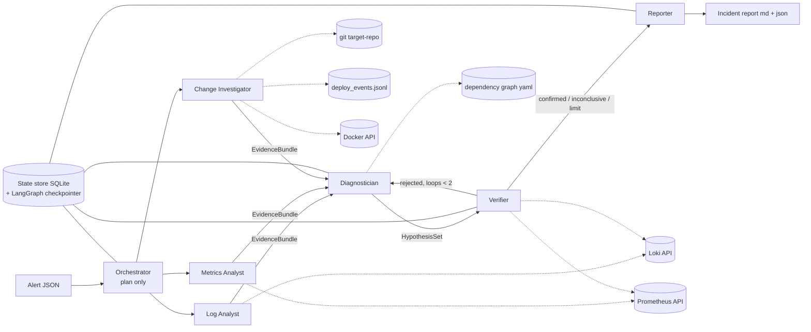
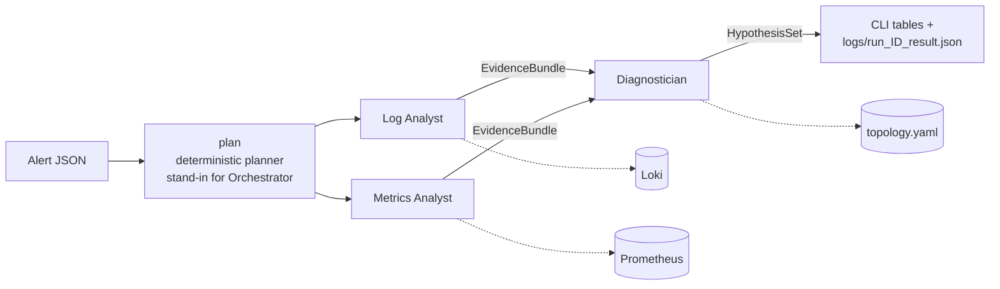
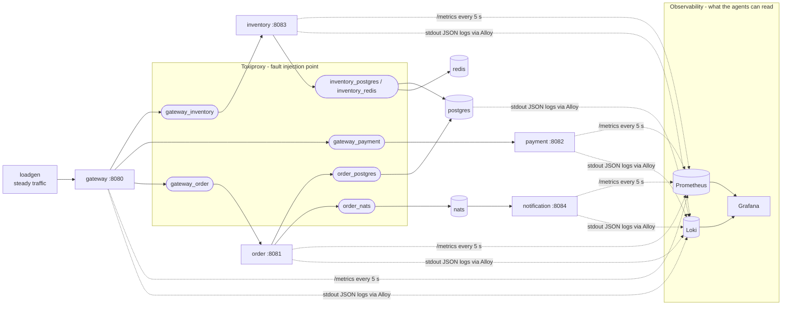

# Architecture

Incident Responder is a multi-agent LLM system. It receives an alert from a microservice backend, investigates logs, metrics and recent changes, identifies the **root cause** (which component, which type of fault), verifies it and writes an incident report.

The repository has three parts:

| Part | What it is | Code |
|---|---|---|
| **Agent system** (the product) | 7 agents wired with LangGraph | `agents/responder/` |
| **System under investigation** (the stage) | Go food-ordering backend + Prometheus/Loki/Grafana | `services/`, `infra/`, `docker-compose.yml` |
| **Harness** (the judge) | fault injection, scenarios with ground truth, evaluation | `chaos/`, `scenarios/`, `loadgen/`, `eval/` |

---

## 1. Agent interaction scheme




Solid arrows are structured messages (Pydantic models serialized as JSON; see [messages.md](messages.md)). Dotted arrows are tool calls to external data sources.

**Pattern:** orchestrator, then parallel specialists, then a verification loop (hierarchical, with a pipeline tail).

1. **Orchestrator** turns the alert into an `InvestigationPlan`: a time window, focus services, and one `Task` per specialist. It only plans: 1 LLM call, 0 tools.
2. **Three specialists run in parallel**, each with its own data source and at most 4 tools. Each returns an `EvidenceBundle`.
3. **Diagnostician** combines all evidence into ranked `Hypothesis`es, using the static dependency graph.
4. **Verifier** independently tests the top hypothesis with fresh queries. If it rejects the hypothesis, the Diagnostician tries again (at most 2 loops).
5. **Reporter** writes the `IncidentReport` (Markdown + JSON).

**Routing is code, not LLM calls.** The edges between nodes are LangGraph edges and conditional edges written in Python. No agent decides who runs next. This keeps the control flow deterministic and testable, and keeps the Orchestrator's share of calls small.

**Agent roles, inputs, outputs and tools:** [agents.md](agents.md).

### Phase 1 prototype (implemented)



`graph.py` wires exactly this. The two specialists are LangGraph nodes reached from the same node, so they run in parallel. `add_edge([log_analyst, metrics_analyst], diagnostician)` makes the Diagnostician wait for both. Every LLM call and tool call is written to `logs/run_<id>.jsonl`.

---

## 2. Inside one agent: the bounded tool loop

Every LLM agent is the same loop (`runtime.py`), parameterized by a prompt, at most 5 tools and an output schema:

```
system prompt + task (JSON)
        │
        ▼
   ┌─► LLM call ──► tool calls? ──yes──► run tools (validated args, retries, logged) ─┐
   │                    │no                                                           │
   │                    ▼                                                             │
   │             final JSON ──► Pydantic validation ──ok──► typed output              │
   │                                  │invalid                                        │
   │                                  ▼                                               │
   │                      1 repair call ──still invalid──► AgentFailure               │
   └──────────────────────────────────────────────────────────────────────────────────┘
   limits: MAX_LLM_CALLS_PER_AGENT=3, MAX_TOOL_CALLS_PER_AGENT=4 (the last LLM call has tools disabled)
```

- Tools receive typed arguments (Pydantic). Time arguments are optional and default to the task's window.
- Tools return **summaries**, not raw data: pattern counts, z-scores, level shifts. Results are capped at ~1.5k tokens.
- Transient errors (network, 5xx, rate limits) are retried 3× with exponential backoff (`tenacity`). Errors the LLM can fix (bad PromQL, 4xx) are returned to it as `{"error": …}`.
- A failed agent never crashes the graph. It returns `AgentFailure`, its bundle is marked `failed`, and the Diagnostician is told which source is missing.

---

## 3. System under investigation




Phase 1 runs gateway, order, payment, postgres and the full observability stack. Inventory, notification, redis and nats arrive in Phase 2.

- **Every service-to-dependency connection goes through Toxiproxy.** Latency, timeouts and outages can be injected without touching service code.
- **Uniform telemetry** comes from the shared `pkg/obs` package:
  - JSON logs with fields `ts, level, service, msg, route, method, status, latency_ms, trace_id, error, upstream`
  - standard metrics `http_requests_total`, `http_request_duration_seconds`, `upstream_request_*`, `db_*`, `build_info`, …
- **`target-repo/`** is a separate git repository with a copy of `services/`. Compose builds the images from it, so "bad deploy" scenarios produce real commits and real `build_info{commit}` changes.

### Anti-leakage boundary

The agents must find the root cause the way an on-call engineer would. They may read: Prometheus, Loki, git history of `target-repo`, the deploy log, and Docker state. They can **never** see:

- `scenarios/`, `chaos/`, the Toxiproxy API, `/admin/chaos`;
- Toxiproxy and loadgen logs: Alloy ships logs only from the system's own components;
- the scenario id: the alert file contains only the symptom.

`agents/tests/test_tools_registry.py` enforces the tool allow-list.

---

## 4. One investigation, step by step

1. `make scenario S=s01`: the harness adds a 2 s latency toxic to `gateway→payment`, waits 90 s, and writes `alerts/s01.json` (`HighLatency` on gateway).
2. `make investigate ALERT=alerts/s01.json`: the CLI loads the alert and builds the plan. The window is 15 min before the alert until now; the focus is gateway and its dependencies.
3. **Log Analyst** calls `error_pattern_summary()`. It finds that `WARN slow upstream response upstream=payment` started at the injection time.
4. **Metrics Analyst** calls `targets_health()` and `zscore_anomaly()` on upstream p95 latency. It finds that gateway→payment latency jumped from ~0.06 s to ~2 s, while payment's own server latency is unchanged.
5. **Diagnostician** reads both bundles plus the dependency graph. It returns `payment / latency` and cites the evidence ids.
6. The call log `logs/run_<id>.jsonl` holds one line per LLM call and per tool call. The final state is saved in `logs/run_<id>_result.json`.
