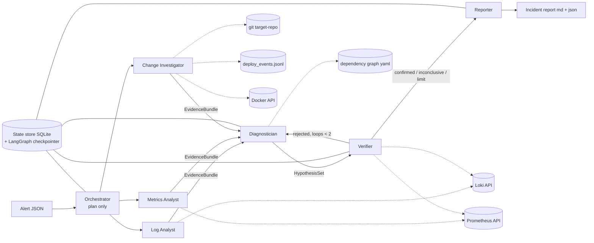
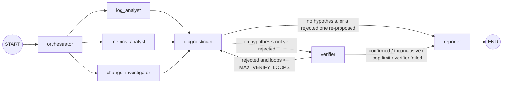

# Architecture

Incident Responder is a multi-agent LLM system. It receives an alert from a microservice backend, investigates logs, metrics and recent changes, identifies the **root cause** (which component, which type of fault), verifies it and writes an incident report.

The repository has three parts:

| Part | What it is | Code |
|---|---|---|
| **Agent system** (the product) | 7 agents wired with LangGraph | `agents/responder/` |
| **System under investigation** (the stage) | Go food-ordering backend + Prometheus/Loki/Grafana | `services/`, `infra/`, `docker-compose.yml` |
| **Harness** (the judge) | fault injection, scenarios with ground truth, evaluation | `chaos/`, `scenarios/`, `loadgen/`, `eval/` |

---

## 1. Agent interaction scheme




Solid arrows are structured messages (Pydantic models serialized as JSON; see [messages.md](messages.md)). Dotted arrows are tool calls to external data sources.

**Pattern:** orchestrator, then parallel specialists, then a verification loop (hierarchical, with a pipeline tail). All seven agents are implemented.

1. **Orchestrator** turns the alert into an `InvestigationPlan`: a time window, focus services, and one `Task` per specialist. It only plans: 1 LLM call, 0 tools.
2. **Three specialists run in parallel**, each with its own data source and at most 4 tools. Each returns an `EvidenceBundle`.
3. **Diagnostician** combines all evidence into ranked `Hypothesis`es, using the static dependency graph.
4. **Verifier** independently tests the top hypothesis with fresh queries. If it rejects the hypothesis, the Diagnostician tries again (at most 2 loops).
5. **Reporter** writes the `IncidentReport` (Markdown + JSON).

**Routing is code, not LLM calls.** The edges between nodes are LangGraph edges and conditional edges written in Python. No agent decides who runs next. This keeps the control flow deterministic and testable, and keeps the Orchestrator's share of calls small.

**Agent roles, inputs, outputs and tools:** [agents.md](agents.md).

### How the graph is wired (`agents/responder/graph.py`)



- **Parallel specialists.** The three specialists are reached from the same node, so LangGraph runs them in parallel. `add_edge([log, metrics, change], diagnostician)` makes the Diagnostician wait for all three.
- **Routing.** Both conditional edges are small Python functions (`after_diagnostician`, `after_verifier`) that read the state.
- **Loop protection.** The key of a hypothesis is `root_cause_service/fault_type`. If the Diagnostician re-proposes a key the Verifier already rejected, the loop ends.
- **Final decision.** The final root cause, confidence and status are set by a pure function (`reporter.final_decision`):
  - the confidence goes up if the hypothesis was confirmed, down if it was inconclusive, rejected or never verified;
  - each failed specialist lowers it further and makes the report `partial`.
- **State.** `GraphState` is a typed dict:
  - `plan`, `bundles`, `hypotheses` (the latest), `verdicts`, `rejected`, `verify_loops`, `report`, `failures`;
  - every node also saves its output to `data/incidents.db` (`state_store.py`);
  - LangGraph's `SqliteSaver` checkpoints the graph state to `data/checkpoints.db` after every step.

---

## 2. Inside one agent: the bounded tool loop

Every LLM agent is the same loop (`runtime.py`), parameterized by a prompt, at most 5 tools and an output schema:

```
system prompt + task (JSON)
        │
        ▼
   ┌─► LLM call ──► tool calls? ──yes──► run tools (validated args, retries, logged) ─┐
   │                    │no                                                           │
   │                    ▼                                                             │
   │             final JSON ──► Pydantic validation ──ok──► typed output              │
   │                                  │invalid                                        │
   │                                  ▼                                               │
   │                      1 repair call ──still invalid──► AgentFailure               │
   └──────────────────────────────────────────────────────────────────────────────────┘
   limits: MAX_LLM_CALLS_PER_AGENT=3, MAX_TOOL_CALLS_PER_AGENT=4 (the last LLM call has tools disabled)
```

- Tools receive typed arguments (Pydantic). Time arguments are optional and default to the task's window.
- Tools return **summaries**, not raw data: pattern counts, z-scores, level shifts. Results are capped at ~1.5k tokens.
- Transient errors (network, 5xx, rate limits) are retried 3× with exponential backoff (`tenacity`). Errors the LLM can fix (bad PromQL, 4xx) are returned to it as `{"error": …}`.
- A failed agent never crashes the graph. It returns `AgentFailure`, its bundle is marked `failed`, and the Diagnostician is told which source is missing.

---

## 3. System under investigation


All of it runs in Docker Compose (`make up`):
- **gateway** — the public API. `POST /api/orders` = inventory `/reserve` → payment `/charge` (3 retries) → order `/orders`.
- **inventory** — reads the product list from a Redis cache, falling back to Postgres.
- **order** — writes orders to Postgres in a transaction, then publishes `orders.created` to NATS.
- **payment** — a mocked external provider.
- **notification** — consumes `orders.created` events.

A load generator sends ~10 rps of realistic traffic all the time. The database connections carry a constant ~20 ms network round trip, modelling a separate database server (see design decisions).

- **Every service-to-dependency connection goes through Toxiproxy.** Latency, timeouts and outages can be injected without touching service code.
- **Uniform telemetry** comes from the shared `pkg/obs` package:
  - JSON logs with fields `ts, level, service, msg, route, method, status, latency_ms, trace_id, error, upstream`
  - standard metrics `http_requests_total`, `http_request_duration_seconds`, `upstream_request_*`, `db_*`, `build_info`, …
- **`target-repo/`** is a separate git repository with a copy of `services/`. Compose builds the images from it, so "bad deploy" scenarios produce real commits and real `build_info{commit}` changes.
- **The deploy simulator** (`chaos/deploy_sim.py`) makes real releases: `git apply` a patch, bump `VERSION`, commit as a (fictional) team member, rebuild, append to `data/deploy_events.jsonl`. Before every scenario it also makes two **harmless** releases in unrelated services, so "the latest deploy is guilty" is not a winning strategy.
- **In-process faults** (memory leak, goroutine leak, CPU burn) are switched on through `/admin/chaos` on each service's internal port 9000. The port is not published, and switching is not logged.

### Anti-leakage boundary

The agents must find the root cause the way an on-call engineer would. They may read: Prometheus, Loki, git history of `target-repo`, the deploy log, and Docker state. They can **never** see:

- `scenarios/`, `chaos/`, the Toxiproxy API, `/admin/chaos`;
- Toxiproxy and loadgen logs: Alloy ships logs only from the system's own components;
- the internal admin port (`:9000`): unpublished, and toggling a fault leaves no log line;
- the scenario id: the alert file contains only the symptom.

`agents/tests/test_tools_registry.py` enforces the tool allow-list.

---

## 4. One investigation, step by step

A real run on s01 (17 Oct 2026, `gemini-3.1-flash-lite`, 27 calls, 95 s). The alert only says: *gateway HighLatency, p95 of POST /api/orders > 1 s*.

1. **Harness.** `make scenario S=s01`:
   - reset, then two harmless deploys (inventory cache TTL, notification text);
   - 2 min of normal traffic, then +2 s latency on gateway→payment;
   - 90 s later, `alerts/s01.json` is written.
2. **Orchestrator** (1 LLM call). It plans a 10-minute window and focuses on gateway and everything it calls, with one objective per specialist.
3. **The three specialists run in parallel:**
   - *Log Analyst:* `error_pattern_summary` finds 427 `WARN slow upstream response upstream=payment` lines, ≈ 2 s each.
   - *Metrics Analyst:* `zscore_anomaly` shows gateway→payment p95 at 2.89 s vs 0.09 s baseline (z = 100), while the 5xx ratio is unchanged.
   - *Change Investigator:* `deploy_events`, `docker_inspect` and `git_diff` find the two deploys 151–152 s before the alert. It rates the cache-TTL change 0.6 and the text change 0.1; all containers are running with no restarts.
4. **Diagnostician** (`dependency_graph` + 1 answer): **payment / latency**, confidence 0.9. It cites the logs and metrics evidence and ignores both deploys.
5. **Verifier** (2 fresh queries): gateway→payment p95 is still 2.95 s and the other dependencies are normal; gateway logs show ~2 s payment calls. Verdict: **confirmed**.
6. **Reporter.** `final_decision` raises the confidence to 1.0 (confirmed) with status `complete`. The LLM writes the summary, timeline and 4 recommended actions, and `write_report` saves `reports/<incident_id>.md/.json`.
7. Every one of the 27 LLM and tool calls is in `logs/run_<id>.jsonl`; every node's output is in `data/incidents.db`.
